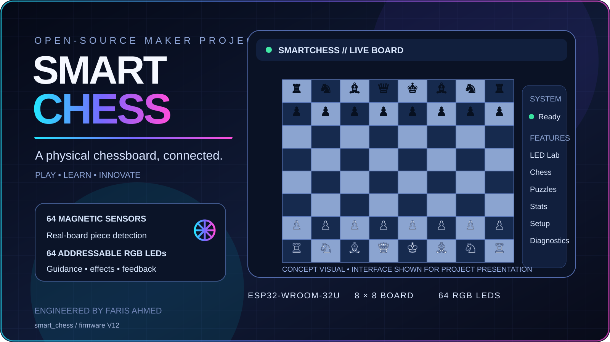
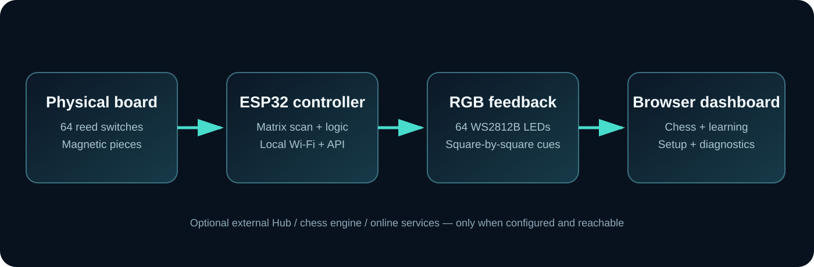

<div align="center">



# Smart Chess

### A physical chessboard that connects the real board to intelligent digital feedback.

[](#hardware)
[](#hardware)
[](#hardware)
[](#hardware)

**Smart Chess** combines a magnetic-piece sensing board, individually addressable RGB lighting, ESP32 firmware, and a responsive browser dashboard. The goal is to make chess more interactive: the physical board can detect piece placement and provide visual feedback while the digital interface supports chess, learning, board setup, and diagnostics.

</div>

---

## Project at a glance



| Part | Description |
|---|---|
| Controller | ESP32-WROOM-32U |
| Board | 8 × 8 physical chessboard |
| Piece sensing | 64 reed switches in a row/column matrix |
| Square lighting | 64 WS2812B RGB LEDs |
| Local connection | ESP32 Wi-Fi access point |
| Main dashboard | `http://192.168.4.1/app` |
| Hardware console | `http://192.168.4.1/` or `/hardware` |

## What Smart Chess is designed to do

- **Physical board tracking** — detect magnetic chess pieces using the 64-switch matrix.
- **Visual move guidance** — use board lighting to communicate square states and move feedback.
- **Chess experience** — support local chess play, move history, and chess-related tools in the dashboard.
- **Learning and puzzles** — provide an interactive path for practicing chess concepts.
- **Light Lab** — control LED colors, brightness, animations, and custom lighting patterns.
- **Hardware diagnostics** — inspect sensor activity, mapping, sensitivity, calibration, and device status.
- **Physical arcade mode** — use the board and LEDs as an input/output surface for small games.
- **Integration-ready design** — allow future connection to a real chess engine or external service without pretending those services are available when they are not.

> Feature availability depends on the exact firmware build and connected services. External Stockfish analysis, Chess.com data, and online multiplayer require their own working integrations or a reachable server.

## Hardware

### Main components

- ESP32-WROOM-32U development board
- 64 reed switches
- 64 WS2812B addressable RGB LEDs
- Magnetic chess pieces
- 8 row connections and 8 column connections
- Suitable regulated power supply and common ground for the LED system

### Current documented pin assignments

**LED strip**
- Data: GPIO 2
- LED count: 64
- LED type: WS2812B
- Color order: GRB

**Matrix rows**

| Row | GPIO |
|---|---:|
| R1 | 13 |
| R2 | 14 |
| R3 | 16 |
| R4 | 17 |
| R5 | 18 |
| R6 | 19 |
| R7 | 21 |
| R8 | 22 |

**Physical matrix columns**

| Physical column | GPIO |
|---|---:|
| C1 | 23 |
| C2 | 25 |
| C3 | 26 |
| C4 | 27 |
| C5 | 32 |
| C6 | 33 |
| C7 | 4 |
| C8 | 5 |

The documented logical-file mapping is **GPIO 27, 4, 5, 23, 32, 26, 33, 25** for files A–H. The firmware's saved mapping and the actual assembled board should always be checked before wiring changes.

## Getting started

1. Install Arduino IDE.
2. Install the Espressif ESP32 board package.
3. Select an ESP32-WROOM-32U-compatible board profile and the correct serial port.
4. Install the libraries required by the selected firmware version (including FastLED where used).
5. Open `firmware/SmartChess_V12_COMPLETE_SINGLE_FILE.ino`.
6. Verify/compile before uploading.
7. Connect to the board's Wi-Fi access point.
8. Open the main dashboard or hardware console in a browser.

### Current development access point

| Setting | Value |
|---|---|
| Wi-Fi network name (SSID) | `SmartChess-Test` |
| Password | `12345678` |
| ESP32 address | `192.168.4.1` |
| Main dashboard | `http://192.168.4.1/app` |
| Hardware console | `http://192.168.4.1/` |

This is a **local access point**. Joining it does not automatically provide internet access. Online multiplayer, cloud services, or external chess analysis need a separate reachable connection.

## Repository structure

```text
smart_chess/
├── README.md
├── LICENSE
├── .gitignore
├── firmware/
│   └── SmartChess_V12_COMPLETE_SINGLE_FILE.ino
├── docs/
│   ├── HARDWARE.md
│   ├── PINOUT.md
│   ├── INSTALLATION.md
│   └── TESTING.md
└── assets/
    ├── smart-chess-banner-v2.svg
    ├── smart-chess-banner.svg
    └── system-architecture.svg
```

## Project status and verification

The **V12 single-file firmware is included** in `firmware/SmartChess_V12_COMPLETE_SINGLE_FILE.ino`. The source has been committed to the public repository; it has not been independently compiled or tested on the assembled board in this update.

| Verification level | Status |
|---|---|
| Firmware source | V12 source committed |
| Arduino compilation | Not independently verified here |
| Browser testing | Not independently verified here |
| Physical board testing | Requires the assembled hardware |
| External integrations | Require their respective services and credentials/authorization |

A previous V11 build was reported to exceed its selected application partition. That measurement does **not** establish the size or compile status of V12. Compile the exact V12 sketch with the intended board and partition settings before treating it as a verified release.

## Documentation

- [Hardware overview](docs/HARDWARE.md)
- [Pinout and matrix mapping](docs/PINOUT.md)
- [Installation guide](docs/INSTALLATION.md)
- [Test checklist](docs/TESTING.md)
- [OpenChess 3D model reference and compatibility notes](docs/3D_MODEL_REFERENCE.md)

## Contributing

Issues, testing notes, wiring corrections, and feature improvements are welcome. When reporting a bug, include the firmware version, ESP32 board selection, Arduino compile output (if relevant), and the exact steps to reproduce it. Never include Wi-Fi passwords, API tokens, or other secrets in public issues.

## License

See [LICENSE](LICENSE).